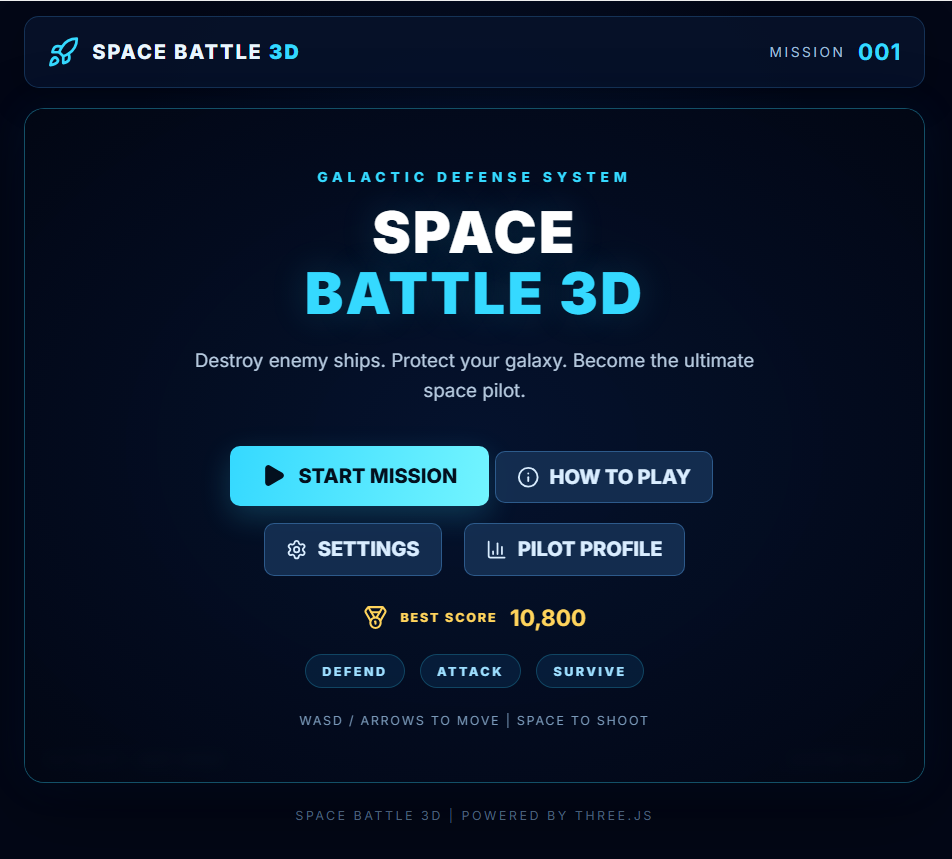
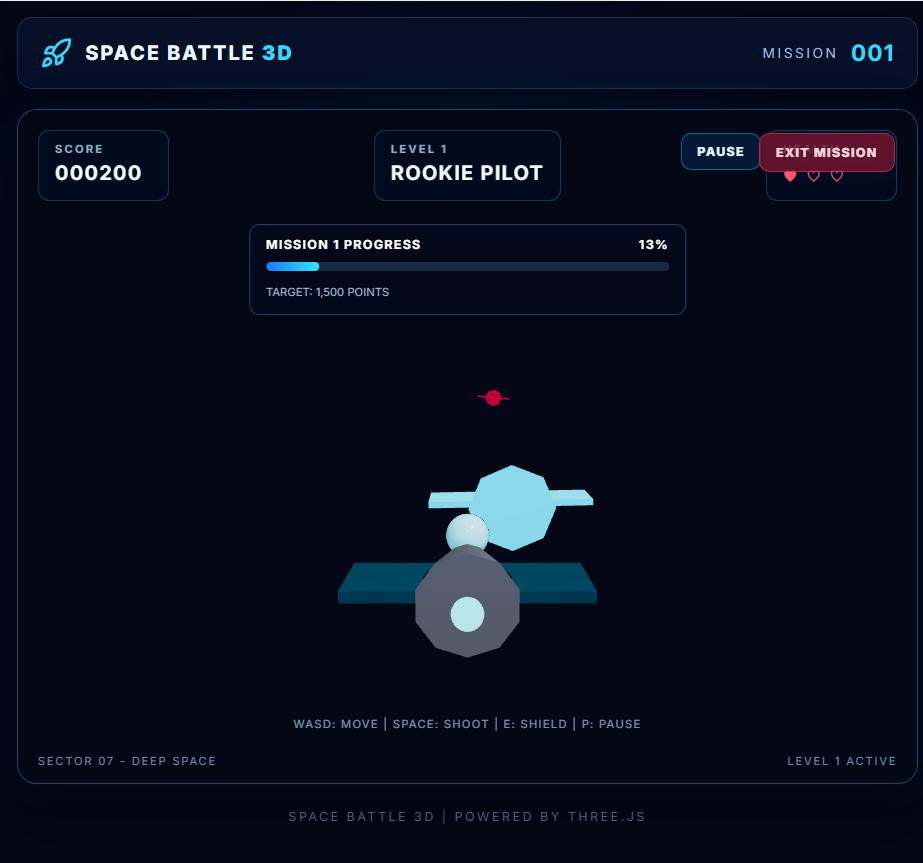
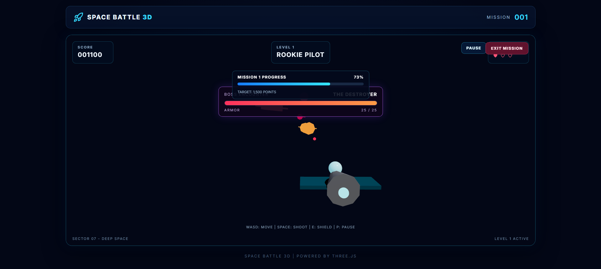
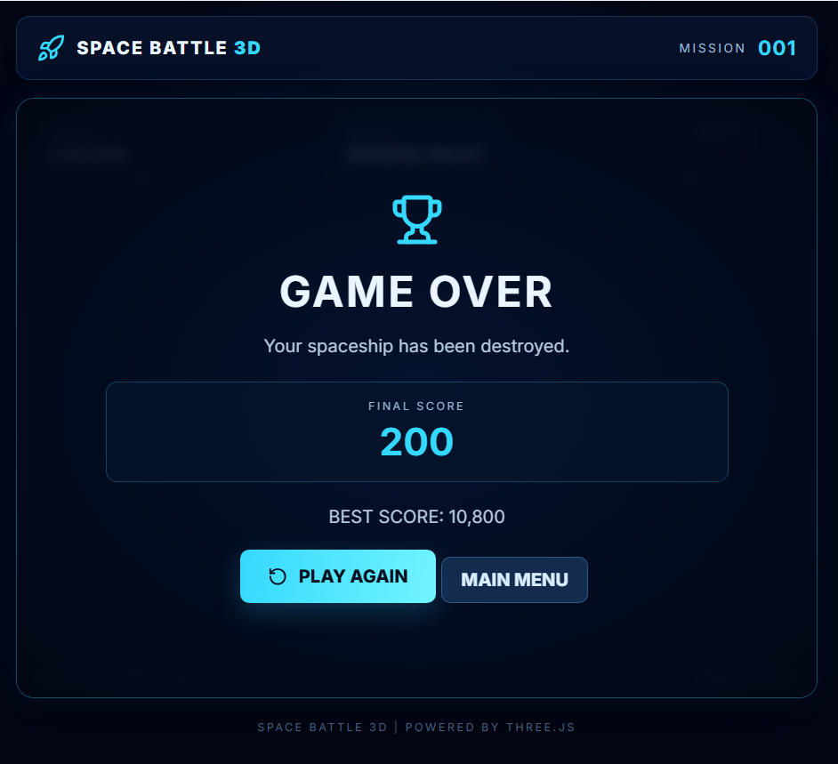

# React + Vite
- [@vitejs/plugin-react](https://github.com/vitejs/vite-plugin-react/blob/main/packages/plugin-react) uses [Oxc](https://oxc.rs)
- [@vitejs/plugin-react-swc](https://github.com/vitejs/vite-plugin-react/blob/main/packages/plugin-react-swc) uses [SWC](https://swc.rs/)

## React Compiler
[this documentation](https://react.dev/learn/react-compiler/installation).

## Expanding the Oxlint configuration
[TS template](https://github.com/vitejs/vite/tree/main/packages/create-vite/template-react-ts) 

## Screenshots

### Main Menu

### Gameplay

### Boss Battle

### Victory Screen
